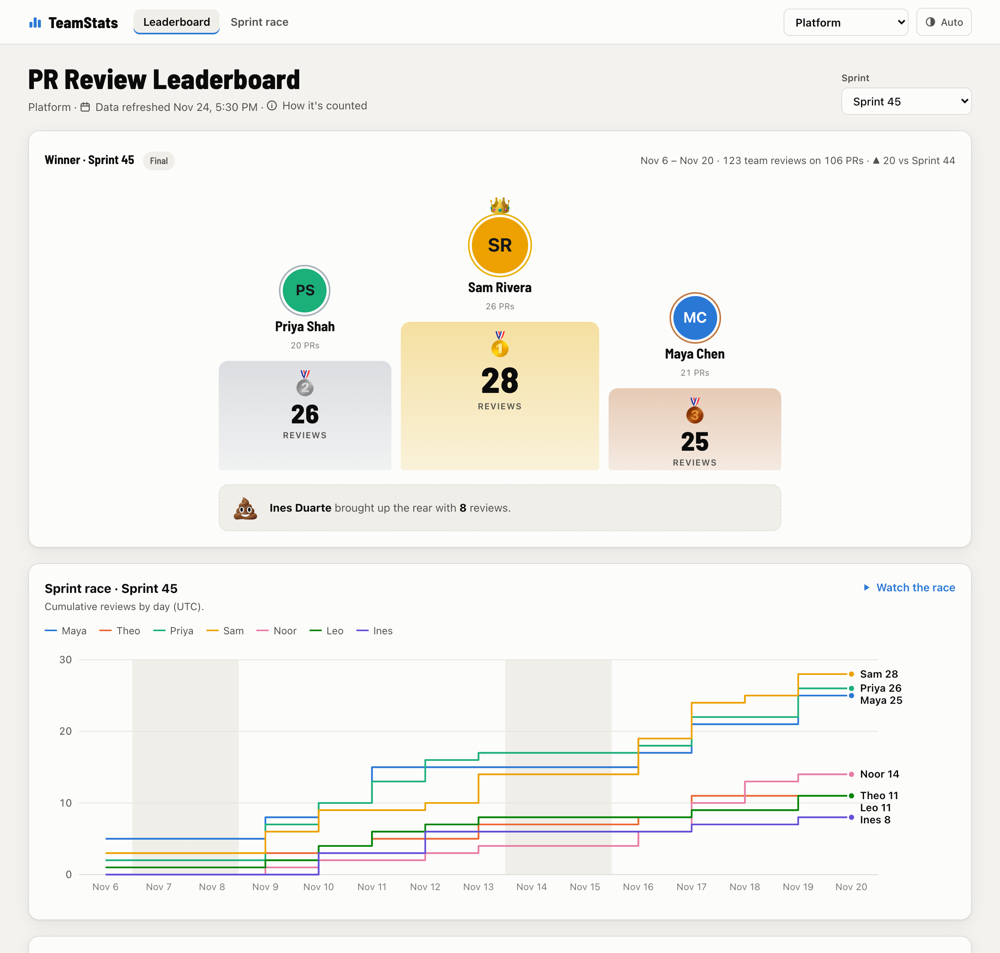
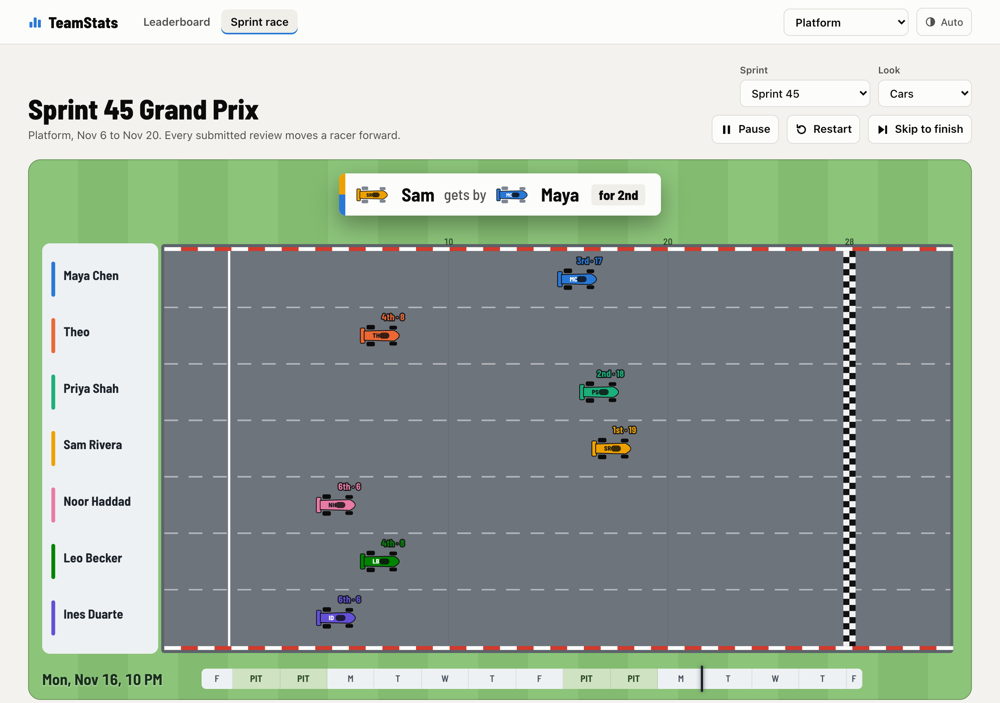

# TeamStats

Sprint reports for engineering managers, built from your team's GitHub reviews and Jira sprints. They're plain HTML files that open in your browser, with no server and nothing to install beyond two command line tools.





*Invented sample data. [Try the live demo](https://aseniah.github.io/team-stats/demo/pr-reviews.html).*

- **PR review leaderboard.** See who reviewed the most pull requests each sprint, how reviews built up day by day, and how each person trends across sprints.
- **Sprint race.** Replay a sprint's reviews as a one minute animated race, made for a retro screen share, in three looks: cars, horses and sleds.
- **Several teams.** Switch between teams from the top bar.
- **Private by default.** Your config, data and generated pages never leave your machine or get committed.

## Use

```bash
./refresh.sh
```

Adds any new sprints from Jira, pulls the latest reviews from GitHub, rebuilds the pages and opens the leaderboard. Run it whenever you want fresh numbers, such as each morning or right after you close a sprint for a retro.

```bash
./open.sh        # the leaderboard
./open.sh race   # the sprint race
```

Opens the pages from the last refresh without fetching anything. To refresh without opening a browser, run `./refresh.sh --no-open`.

## Set up

Prefer to be walked through it? See [Set up with Claude Code](#set-up-with-claude-code).

### 1. Install the tools

```bash
brew install node gh
gh auth login
```

Node 26 or later is needed. There is nothing to `npm install`. Your GitHub login needs read access to the org's repositories. If the org uses SSO, authorize it on the GitHub page that `gh auth login` opens.

### 2. Add a Jira token

Create an API token at [id.atlassian.com](https://id.atlassian.com/manage-profile/security/api-tokens) with **Create API token**. Then copy `env.example` to `.env` and fill in:

```bash
JIRA_EMAIL=you@example.com
JIRA_API_TOKEN=your-token
JIRA_SITE=acme              # the part before .atlassian.net in your Jira URL
JIRA_TOKEN_EXPIRES=2027-11-01   # optional; the refresh warns two weeks before
```

Tokens last at most a year. When yours expires, the refresh says so and you create a new one.

### 3. Describe your teams

Copy `config/teams.example.json` to `config/teams.json` and edit it. It holds a list of teams, each like this:

```json
[
  {
    "id": "platform",
    "name": "Platform",
    "githubOrg": "acme",
    "lastPlaceEmoji": "💩",
    "jira": { "boardId": 42 },
    "members": [
      { "id": "ada", "name": "Ada Park", "github": "ada-gh", "from": "2026-01-01", "to": null },
      { "id": "ben", "name": "Ben Ortiz", "displayName": "Benny", "github": "ben-gh", "from": "2026-01-01", "to": null }
    ]
  }
]
```

- **`id`** appears in links and saved settings, so pick it once and never change it. Use lowercase letters, digits and dashes.
- **`boardId`** is the number in your Jira board's URL, as in `.../boards/42`.
- **Members** need a GitHub login and the date they joined (`from`). When someone leaves, set `to` to the date they left instead of deleting them, so past sprints keep their numbers.
- **`name`** is the person's full name. Charts show its first word unless you set **`displayName`**, for a nickname or preferred name, or to tell apart two people with the same first name.
- **`lastPlaceEmoji`** is optional. Leave it out to show last place like any other place.

Then run `./refresh.sh`. The first run adds the last year of sprints and pulls their reviews, which can take several minutes.

`config/teams.example.json` shows the remaining options, such as turning Jira sprint names into short labels. `AGENTS.md` covers every field and exactly how reviews are counted.

## Set up with Claude Code

Claude Code can walk you through the setup instead. It still needs the tools and Jira token from steps 1 and 2, and checks for them. Add the Atlassian MCP so it can look up your Jira board and sprints:

```bash
claude mcp add --transport http atlassian https://mcp.atlassian.com/v2/mcp
```

Then open this folder in Claude Code and ask "Set up TeamStats." It:

- Checks your tools, your Jira token and any teams already configured, and offers to fix what is missing.
- Finds your team's Jira board.
- Suggests members from recent sprint tickets, with their GitHub logins, for you to confirm.
- Asks how each person's name should show on charts.
- Suggests short sprint labels from your sprint names.
- Seeds past sprints and pulls their reviews.

Ask again any time to check the setup or add another team. "Refresh team stats" runs the refresh and summarizes the standings.

## Contributing

Issues and pull requests are welcome.

### Get set up

```bash
brew install node shellcheck
npm install
```

`npm install` adds only the development tools, such as Biome for linting and formatting. The reports themselves never need it.

### Try a change without real data

```bash
npm run demo                                 # the demo teams, written to docs/demo/
node scripts/build-reports.mjs --scenarios   # edge cases such as ties, a late joiner and a live sprint, written to test/output/
```

Open the pages in `docs/demo/` or `test/output/` and check them in both light and dark mode.

### Before you open a pull request

- Run `npm run fix`, then `npm run check`, which runs Biome, shellcheck and the unit tests. CI runs the same check on every pull request.
- Put new logic in `lib/` with unit tests in `test/`, using invented names and orgs.
- Keep anything specific to one team or company out of the code. Behavior that differs between teams becomes a field in `config/teams.json` with a sensible default.
- To add a race look, copy `reports/src/race-themes/cars.js` to a new file, give it a new `id` and `label`, and change its drawing, words and palette. The build picks it up, the Look menu lists it, and `test/race-themes.test.mjs` checks its shape.
- If someone running TeamStats would notice the change, bump `version` in `package.json` and add a matching entry at the top of `CHANGELOG.md`.
- If a page looks different, rebuild the demo with `npm run demo`, and retake the screenshots in `docs/` when what they show changed.

`AGENTS.md` describes the layout, the counting rules and every config field. Claude Code reads it automatically, so agent-written changes follow the same rules.

## License

[MIT](LICENSE)
